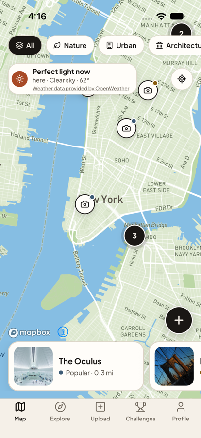
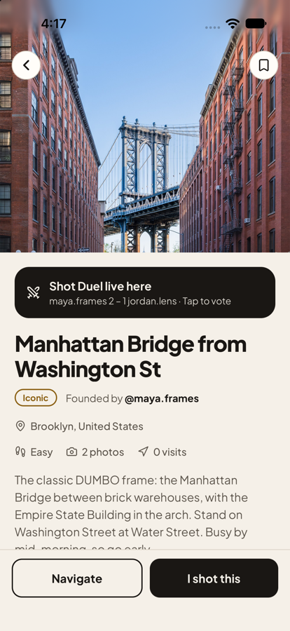
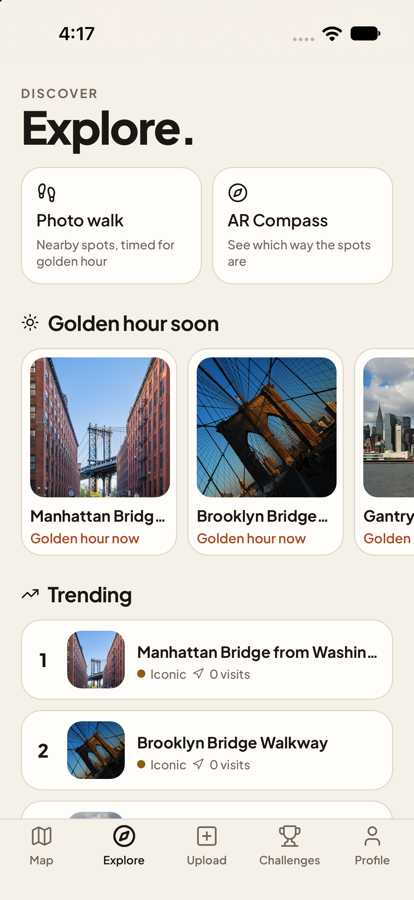
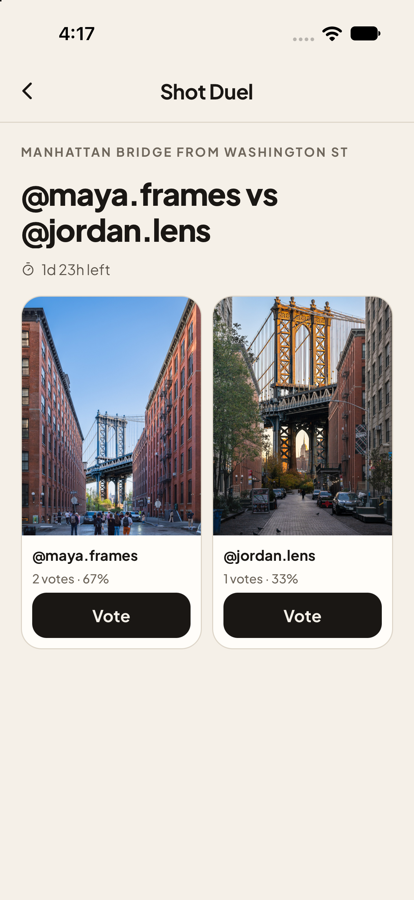
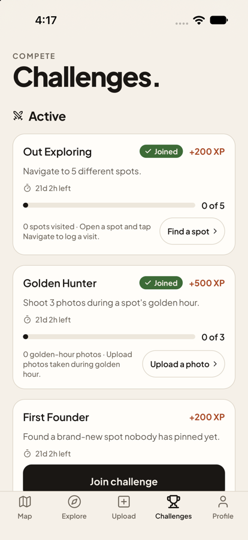
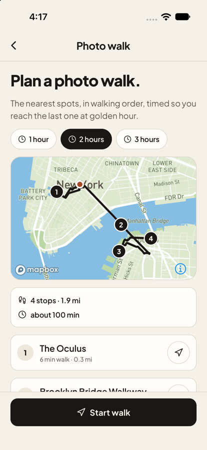

# ClickIt

**Find the shot. Own the spot.**

ClickIt is an iPhone app that helps photographers find great photo spots, at the exact place to stand and the best time to shoot. People pin real locations with their photos, and the app turns exploring into a game with XP, ranks, challenges and photo duels.

  
  
  

  
  
  

## Who it's for

Photographers and travelers, from beginners with a phone to people with a camera bag, who want to know *where* the good shots are and *when* the light will be right.

## Features

- **Spot map:** every spot is a pin at its exact location. Nearby pins group together when you zoom out, and zooming all the way out shows a 3D globe. Filter by Nature, Urban, Architecture, Golden Hour, Hidden Gems or Rooftop.
- **Golden-hour timing:** the app calculates golden hour for any location from the sun's position, shows a live countdown with current weather, and can send an alert 45 minutes before golden hour at spots you've saved nearby.
- **Pin a spot:** take or choose a photo. ClickIt reads the location saved in the photo (or you drop a pin), checks for an existing spot within 50 m to avoid duplicates, strips the photo's hidden metadata, compresses it and publishes it.
- **XP and ranks:** earn XP for founding spots, adding photos, getting upvotes and completing challenges, and rank up from Bronze to Legend. Badges are awarded automatically.
- **Challenges:** time-limited goals (for example, visit 5 spots) with progress tracking.
- **Shot Duels:** challenge another photographer who shot the same spot; the community votes for 72 hours and the winner earns XP.
- **Photo walk:** plans a 1–3 hour walking route through nearby spots, timed to reach the last one at golden hour.
- **AR Compass:** shows which direction nearby spots are, on a radar or over the live camera.
- **Accounts and privacy:** email sign-up with confirmation, password reset, profile editing, and in-app account deletion.

## How it's built

| Part | Technology |
|---|---|
| App | React Native 0.85 + Expo SDK 56, TypeScript (strict) |
| Map | Mapbox (`@rnmapbox/maps`) with Supercluster for pin clustering |
| Backend | Supabase: Postgres database, authentication, row-level security |
| Photos | Cloudinary |
| Weather | OpenWeather |
| Sun position | SunCalc algorithm (golden hour, blue hour, sunrise and sunset) |
| State | Zustand |
| Navigation | React Navigation (bottom tabs + stack) |

Game rules live in the database, not the app, so they can't be faked from a phone. XP, badges, challenge progress, upvote counts and duel results are all calculated by Postgres triggers and functions (see [`supabase/migrations`](supabase/migrations)). Row-level security makes sure each user can only change their own data, and spots marked as private property only show an approximate location.

## Built with AI assistance

ClickIt was built by Vishwa Meenakshisundaram using **Claude Code** (Anthropic's AI coding assistant), which wrote most of the code. Commits made with it are marked `Co-Authored-By: Claude` in the history, and [`CLAUDE.md`](CLAUDE.md) holds the project plan and rules it worked from.

Vishwa's role:
- Came up with the app's idea and its features.
- Directed the design: the beige-and-black look, the onboarding flow, the map style and the screen layouts.
- Reviewed every change in the simulator, asking for fixes or for changes to be undone when something didn't feel right.
- Set up and connected the services (Supabase, Mapbox, Cloudinary and OpenWeather), ran the database migrations, and tested the app.

## Sample data

So the features can be demonstrated, the map is pre-loaded with **sample data**: 14 real New York City photo spots at their actual locations. Their photos are freely licensed from Wikimedia Commons, and each photographer and license is credited in the spot's description. The spots are posted by five sample accounts, labeled as such in their profiles. The scripts that add and remove this data are in [`supabase/sample-data`](supabase/sample-data).

## Running it yourself

You need Node.js, Xcode (for the iOS simulator) and CocoaPods.

1. `npm install`
2. Create a `.env` file with your own keys: `SUPABASE_URL`, `SUPABASE_ANON_KEY`, `MAPBOX_ACCESS_TOKEN`, `CLOUDINARY_CLOUD_NAME`, `CLOUDINARY_UPLOAD_PRESET` and `OPENWEATHER_API_KEY`.
3. In your Supabase project, run the SQL files in `supabase/migrations` in order (SQL Editor → New query → paste → Run).
4. `npx expo prebuild --platform ios`, then `npx expo run:ios`.

Run `npm run typecheck` and `npm run lint` to check the code.

## Links

- [Support](https://vishwa2010.github.io/click-it/)
- [Privacy Policy](https://vishwa2010.github.io/click-it/privacy.html)
- [Terms of Service](https://vishwa2010.github.io/click-it/terms.html)

## Credits

- Maps © [Mapbox](https://www.mapbox.com/about/maps/) © [OpenStreetMap](https://www.openstreetmap.org/copyright)
- Weather data provided by [OpenWeather](https://openweathermap.org/)
- Sample photos from [Wikimedia Commons](https://commons.wikimedia.org/), credited in each spot
- Icons by [Lucide](https://lucide.dev/)
